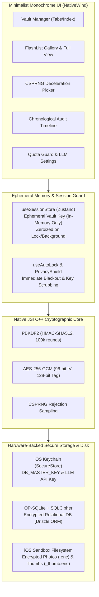

# PocketPick

> **High-Security, Minimalist Mobile Vault & Cryptographic Randomizer for iOS**

PocketPick is an iOS-first, secure mobile application built with React Native, Expo (Custom Dev Client), native JSI C++ cryptography (`react-native-quick-crypto`), SQLCipher, and Drizzle ORM. It enables isolated, password-protected vaults protected by envelope encryption, encrypted photo galleries, a cryptographically fair randomizer engine, local audit history, and ephemeral on-device OCR with quota-controlled LLM analysis.

---

## 1. Tech Stack & Implementation Architecture

### 1.1 Technology Stack

- **Core & Runtime:** React Native `0.88.0` with Expo SDK 58 (Custom Dev Client / Prebuild).
- **Navigation & Routing:** [Expo Router](https://docs.expo.dev/router/introduction/) (file-based stack and tab navigation).
- **Encrypted Relational Storage:** [OP-SQLite](https://github.com/OP-Engineering/op-sqlite) with **SQLCipher (256-bit AES)** + [Drizzle ORM](https://orm.drizzle.team/).
- **Hardware-Backed Storage:** iOS Keychain via `expo-secure-store` with `kSecAttrAccessibleAfterFirstUnlockThisDeviceOnly` protection.
- **Cryptographic Core:** Native JSI C++ via `react-native-quick-crypto`:
  - **KDF:** PBKDF2 with HMAC-SHA512 (100,000 iterations, 32-byte salt).
  - **Symmetric Cipher:** AES-256-GCM (12-byte IV uniquely generated per operation, 16-byte authentication tag, optional AAD vault binding).
  - **Randomizer:** CSPRNG (`QuickCrypto.randomBytes`) with rejection sampling to eliminate modulo bias.
- **State Management:** [Zustand](https://github.com/pmndrs/zustand) with strictly transient, in-memory vault session keys (`useSessionStore`) with memory zeroization on lock.
- **UI & Styling:** [NativeWind v4](https://www.nativewind.dev/) (Tailwind CSS for React Native) adhering to strict high-contrast monochrome design tokens.
- **Media & Performance:** `@shopify/flash-list` for 60 FPS scrolling, `expo-image-manipulator` for local thumbnail generation, and an in-memory LRU cache (`lru-cache`) for bounded thumbnail decryption.
- **On-Device Vision & OCR:** `@react-native-ml-kit/text-recognition` (ephemeral sandbox processing wrapped in mandatory file shredding).
- **Quality Assurance & Testing:** Jest 30, React Native Testing Library, ESLint 9, Prettier, Husky, and [Maestro](https://maestro.mobile.dev/) for E2E flows.

### 1.2 System Architecture & Security Model



### 1.3 Core Security Invariants

1. **Zero-Plaintext Leaks:** Cryptographic keys, raw passphrases, plaintext tickets, and decrypted image buffers are never printed to `console.log` or error traces.
2. **Hardware Key Isolation:** The database master key (`POCKETPICK_DB_MASTER_KEY`) and optional LLM API key are stored exclusively in the iOS Keychain.
3. **No Unencrypted Disk Persistence:** `AsyncStorage` is banned. Unencrypted user content is never written to persistent disk storage.
4. **Transient Session Keys:** Vault keys exist solely in memory inside `useSessionStore` and are actively wiped (`zeroizeBuffer()`) upon lock, inactivity, or application backgrounding.
5. **Defense-in-Depth Shredding:** Ephemeral decrypted files generated during OCR analysis are processed inside a `try ... finally { await shredFile(tempPath); }` block that overwrites bytes before unlinking.
6. **Strict Monthly Quota Guard:** Cloud LLM queries are constrained by a transactional SQLite counter to a maximum of 100 requests per calendar month.

---

## 2. Prerequisites & Native Environment Setup

- **Operating System:** macOS (Apple Silicon or Intel).
- **Node.js:** v20.x+ (LTS) with `npm` v10+.
- **Xcode:** Version 15.0+ installed with iOS Simulator runtimes (e.g. iPhone 15 / 16 Pro).
- **Command Line Tools:** Xcode Command Line Tools installed (`xcode-select --install`).
- **CocoaPods:** `pod` >= 1.13.0 (`sudo gem install cocoapods` or `brew install cocoapods`).
- **Optional (E2E Testing):** [Maestro CLI](https://maestro.mobile.dev/) installed via `curl -fsSL "https://get.maestro.mobile.dev" | bash`.

---

## 3. Getting Started & Development Workflow

### 3.1 Installation

Clone the repository and install dependencies:

```bash
# Clone the repository
git clone https://github.com/kevinwangstats/PocketPick.git
cd PocketPick

# Install JavaScript/TypeScript dependencies
npm install
```

### 3.2 Running Verification & Tests

PocketPick is developed under strict Test-Driven Development (TDD) guidelines:

```bash
# Run unit & component test suite (79 tests across 20 suites)
npm test

# Run tests in watch mode
npm run test:watch

# Run TypeScript typecheck (strict mode)
npx tsc --noEmit

# Run ESLint & code formatting
npm run lint
npm run format

# Execute static and dynamic cryptographic security audit
bash scripts/audit-crypto.sh
```

---

## 4. How to Test on iPhone

Because PocketPick leverages native JSI C++ modules (`react-native-quick-crypto`), SQLCipher (`@op-engineering/op-sqlite`), and the iOS Keychain, standard Expo Go cannot be used. You must use either an **iOS Simulator (via Expo Dev Client)** or a **Physical iPhone (direct deployment via Xcode)**.

---

### Method A: Testing on iOS Simulator (Fastest)

1. **Launch the iOS Simulator and compile the native development build:**

   ```bash
   npx expo run:ios
   ```

   _This command executes `expo prebuild`, generates the `ios/` Xcode workspace, installs CocoaPods dependencies, compiles native C++ libraries, and launches the app on the active iOS Simulator._

2. **Starting the Metro Bundler on subsequent runs:**

   ```bash
   npx expo start --ios
   ```

3. **Key Simulator Workflows to Test:**
   - **Vault Lifecycle:** Create a new vault with a passphrase, lock it, and unlock it. Attempting an incorrect passphrase will fail cleanly without crashing.
   - **App Switcher Privacy Shield:** Put the app in the background (press `Cmd + Shift + H`). Notice that the entire screen is occluded by the pitch-black `PrivacyShield` to prevent the iOS multitasking switcher from caching sensitive tickets or photos.
   - **Encrypted Media:** Import a photo from the simulator camera roll. The original image is encrypted into `.enc` and `_thumb.enc` formats, and unencrypted cache files are immediately shredded.
   - **Randomizer Deceleration:** Go to the `PICK` tab and trigger a pick. Observe the mechanical deceleration counter and tactile haptics.

---

### Method B: Testing on a Physical iPhone (Direct Deploy via Xcode)

You do **not** need an Apple Developer Program paid membership ($99/yr) or TestFlight to test PocketPick on your personal iPhone. You can deploy directly using a free Personal Team / Apple ID via macOS and Xcode.

#### Step 1: Prepare Your Physical iPhone

1. Connect your iPhone to your Mac via USB-C or Lightning cable.
2. If prompted on your iPhone, tap **Trust This Computer** and enter your device passcode.
3. Enable **Developer Mode** on iOS (required on iOS 16, 17, and 18):
   - On your iPhone, open **Settings > Privacy & Security > Developer Mode**.
   - Toggle **Developer Mode** to **ON**.
   - Follow the prompt to restart your iPhone, and tap **Turn On** upon reboot.

#### Step 2: Open the Native Project in Xcode

Generate the native project and open the Xcode workspace:

```bash
# Generate the native iOS workspace if not already present
npx expo prebuild --platform ios

# Open in Xcode
open ios/PocketPick.xcworkspace
```

#### Step 3: Configure Code Signing in Xcode

1. In Xcode's left sidebar, click the top-level **PocketPick** project item.
2. Select the **PocketPick** target and navigate to the **Signing & Capabilities** tab.
3. Check **Automatically manage signing**.
4. In the **Team** dropdown:
   - Select your **Personal Team** (associated with your free Apple ID).
   - If not signed in, click **Add Account...**, sign in with your Apple ID, and select the generated Personal Team.
5. If Xcode displays a bundle identifier conflict with `com.pocketpick.app`, append your initials (e.g. `com.pocketpick.app.yourname`) in the **Bundle Identifier** field.

#### Step 4: Build & Install to Your iPhone

1. At the top of the Xcode window, click the run destination dropdown (next to the "PocketPick" scheme) and select your connected physical iPhone.
2. Press **Command + R** (or click the **Play** button) to compile and install directly onto your device.

#### Step 5: Trust the Developer Profile on iPhone (First Time Only)

When you first attempt to open PocketPick on your device, iOS will show an "Untrusted Developer" dialog:

1. On your iPhone, navigate to **Settings > General > VPN & Device Management**.
2. Under **Developer App**, tap your Apple ID profile.
3. Tap **Trust "[Your Apple ID]"** and confirm.
4. Launch **PocketPick** directly from your iPhone home screen!

> **Quick Helper Script:** You can also run `bash scripts/install-physical-device.sh` in your terminal for a step-by-step interactive reminder.

---

### Method C: Running Automated Maestro E2E Flows

PocketPick includes a full suite of automated end-to-end user journeys using [Maestro](https://maestro.mobile.dev/):

1. Ensure the iOS Simulator is running with the app installed (`npx expo run:ios`).
2. Run the test flows:
   ```bash
   # Execute all automated end-to-end flows
   maestro test .maestro/flows/

   # Or run an individual flow
   maestro test .maestro/flows/01_vault_lifecycle.yaml
   maestro test .maestro/flows/02_ticket_crud.yaml
   maestro test .maestro/flows/03_image_gallery.yaml
   maestro test .maestro/flows/04_random_picker.yaml
   maestro test .maestro/flows/05_privacy_autolock.yaml
   ```

---

## 5. Repository File Layout

```
PocketPick/
├── .agents/                      # Agentic rules, invariants & custom skills
│   ├── rules/                    # security-invariants, minimalist-ui, code-quality
│   └── skills/                   # crypto-audit, db-migration
├── .husky/                       # Git pre-commit hooks (lint-staged, typecheck)
├── .maestro/                     # Automated Maestro E2E test suite
│   ├── config.yaml
│   └── flows/                    # 01_vault_lifecycle ... 05_privacy_autolock
├── plans/                        # Architectural master specifications & phase plans
│   ├── README.md                 # Master Phase Roadmap & Execution Matrix
│   ├── phase_0_bootstrap_and_setup.md
│   ├── phase_1_native_foundation_database.md
│   ├── phase_2_crypto_core_and_vault_management.md
│   ├── phase_3_encrypted_resource_management.md
│   ├── phase_4_random_picker_and_history.md
│   ├── phase_5_ocr_llm_and_quota_guard.md
│   └── phase_6_e2e_testing_audit_distribution.md
├── scripts/                      # Release & security automation
│   ├── audit-crypto.sh           # Security & zero-plaintext leak audit
│   ├── build-ios-release.sh      # Automated Xcode release compilation script
│   └── install-physical-device.sh# Physical iPhone deployment guide script
├── src/
│   ├── app/                      # Expo Router navigation routes
│   │   ├── _layout.tsx           # Root provider stack & PrivacyShield
│   │   ├── (tabs)/               # Bottom tab screens: Vaults, Randomizer, Timeline, Settings
│   │   └── vault/                # Dynamic stack screens: [id].tsx, unlock.tsx
│   ├── components/               # High-contrast monochrome UI components
│   │   ├── ui/                   # Button, Input, Card, Typography
│   │   ├── vault/                # VaultCard, CreateVaultModal, UnlockVaultModal
│   │   ├── tickets/              # TicketCard, TicketEditorModal
│   │   ├── media/                # EncryptedGallery, ThumbnailTile, FullImageModal
│   │   ├── picker/               # ShuffleDisplay, WinnerCard, WeightFilterModal
│   │   ├── history/              # HistoryTimeline, HistoryItemRow
│   │   ├── settings/             # ApiKeySettings, QuotaProgressCard
│   │   ├── llm/                  # LlmAnalysisModal
│   │   └── security/             # PrivacyShield
│   ├── crypto/                   # Native JSI C++ crypto core
│   │   ├── kdf.ts                # PBKDF2 derivation service
│   │   ├── cipher.ts             # AES-256-GCM authenticated cipher
│   │   └── zeroize.ts            # Safe memory scrubbing utility
│   ├── db/                       # OP-SQLite + SQLCipher & Drizzle ORM
│   │   ├── client.ts             # Encrypted database client initialization
│   │   ├── schema.ts             # Relational tables: vaults, resources, history, quotas
│   │   └── security.ts           # Keychain master key generator
│   ├── hooks/                    # useVaultAuth, useAutoLock, usePicker
│   ├── services/                 # Business logic, media, randomizer, OCR & LLM
│   ├── stores/                   # useSessionStore (transient in-memory vault key)
│   └── theme/                    # Monochrome design tokens
└── __tests__/                    # 20 Jest test suites (crypto, db, services, UI)
```

---

## 6. Phased Roadmap Reference

All development phases have been completed and verified against their respective requirements:

| Phase       | Milestone                                                            | Specification                                                     |
| :---------- | :------------------------------------------------------------------- | :---------------------------------------------------------------- |
| **Phase 0** | Environment Bootstrap, Minimalist UI Tokens, Husky, TDD Scaffolding  | [Phase 0 Plan](plans/phase_0_bootstrap_and_setup.md)              |
| **Phase 1** | Native Custom Dev Client, SQLCipher, SecureStore, Drizzle Schema     | [Phase 1 Plan](plans/phase_1_native_foundation_database.md)       |
| **Phase 2** | Native C++ Crypto (PBKDF2/AES-GCM), Session Zeroization, Auto-Lock   | [Phase 2 Plan](plans/phase_2_crypto_core_and_vault_management.md) |
| **Phase 3** | Encrypted Tickets, Zero-Leak Photo Pipeline, FlashList Gallery       | [Phase 3 Plan](plans/phase_3_encrypted_resource_management.md)    |
| **Phase 4** | CSPRNG Randomizer, Mechanical Deceleration UI, Atomic History        | [Phase 4 Plan](plans/phase_4_random_picker_and_history.md)        |
| **Phase 5** | On-Device Ephemeral OCR, Monthly 100-Request Quota Guard, LLM Client | [Phase 5 Plan](plans/phase_5_ocr_llm_and_quota_guard.md)          |
| **Phase 6** | Automated Maestro E2E Flows, Crypto Security Audit, Direct Release   | [Phase 6 Plan](plans/phase_6_e2e_testing_audit_distribution.md)   |

For comprehensive architectural design notes, refer to [plans/README.md](plans/README.md).
