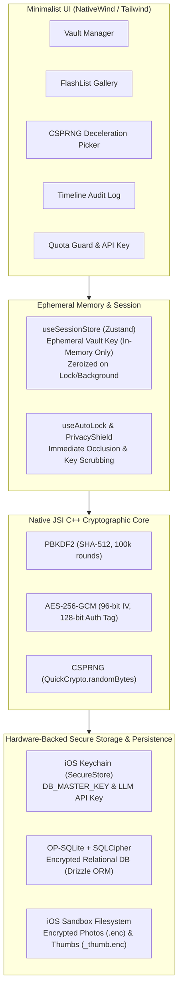
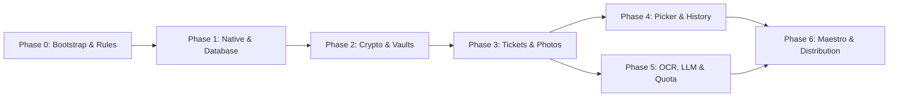

# PocketPick: Master Architecture & Phase Planning Roadmap

> **PocketPick** is a high-security, minimalist mobile application for iOS built using React Native, Expo (Custom Dev Client), SQLCipher, JSI C++ Cryptography (`react-native-quick-crypto`), and Drizzle ORM. It enables isolated, password-protected vaults with envelope encryption, encrypted photo galleries, a cryptographically fair randomizer engine, local audit history, and ephemeral on-device OCR with optional quota-controlled LLM analysis.

---

## 1. System Architecture & Security Model

---

## 2. Phase Execution Matrix

PocketPick is engineered through an iOS-first phased development plan. Each phase has its own dedicated, actionable specification document containing exact tasks, architectural contracts, test strategies, and acceptance criteria:

| Phase       | Title                                            | Primary Focus                                                                                                                                 | Specification Document                                                                                        | Status           |
| :---------- | :----------------------------------------------- | :-------------------------------------------------------------------------------------------------------------------------------------------- | :------------------------------------------------------------------------------------------------------------ | :--------------- |
| **Phase 0** | **Environment Bootstrap & Best Practices**       | Expo TS, Husky pre-commit, Jest/RNTL, monochrome NativeWind design system, `.agents/` rules.                                                  | [Phase 0 Plan](file:///Users/kevinwang/projects/PocketPick/plans/phase_0_bootstrap_and_setup.md)              | ✅ **Completed** |
| **Phase 1** | **Native Foundation & Database Layer**           | Custom Dev Client, CocoaPods, SQLCipher (`op-sqlite`), SecureStore master key, Drizzle schemas, Expo Router.                                  | [Phase 1 Plan](file:///Users/kevinwang/projects/PocketPick/plans/phase_1_native_foundation_database.md)       | ✅ **Completed** |
| **Phase 2** | **Cryptographic Core & Vault Management**        | Native PBKDF2/AES-256-GCM, tamper rejection, `useSessionStore` zeroization, AppState auto-lock & PrivacyShield.                               | [Phase 2 Plan](file:///Users/kevinwang/projects/PocketPick/plans/phase_2_crypto_core_and_vault_management.md) | ✅ **Completed** |
| **Phase 3** | **Encrypted Resource Management**                | Encrypted text tickets, zero-leak photo pipeline (`.enc`), 60 FPS FlashList gallery with bounded thumbnail decryption, secure file shredding. | [Phase 3 Plan](file:///Users/kevinwang/projects/PocketPick/plans/phase_3_encrypted_resource_management.md)    | ✅ **Completed** |
| **Phase 4** | **Random Picker & Local History Tracker**        | CSPRNG unbiased randomizer (weighted & uniform), mechanical deceleration haptics animation, atomic DB transactions, timeline view.            | [Phase 4 Plan](file:///Users/kevinwang/projects/PocketPick/plans/phase_4_random_picker_and_history.md)        | ✅ **Completed** |
| **Phase 5** | **On-Device OCR, LLM Integration & Quota Guard** | Apple Vision / ML Kit ephemeral OCR in strict `finally` block, monthly 100-request quota gate, Keychain LLM API key, inspection sheet.        | [Phase 5 Plan](file:///Users/kevinwang/projects/PocketPick/plans/phase_5_ocr_llm_and_quota_guard.md)          | ✅ **Completed** |
| **Phase 6** | **E2E Testing, Audit & iOS Distribution**        | Automated Maestro E2E test suite, Antigravity crypto-audit skill execution, standalone release build via Xcode directly to physical iPhone.   | [Phase 6 Plan](file:///Users/kevinwang/projects/PocketPick/plans/phase_6_e2e_testing_audit_distribution.md)   | ✅ **Completed** |

---

## 3. Development Invariants & Standards for Developers & AI Agents

### 3.1 Security Invariants

1. **Never Log Sensitive Data:** Passphrases, derived keys, IVs, plaintexts, and unencrypted buffers must never be output via `console.log` or error traces.
2. **Never Persist Session Keys:** Vault keys exist solely in transient memory inside `useSessionStore`. They are scrubbed with `zeroizeBuffer()` upon vault locking, inactivity timeout, or app backgrounding.
3. **Always Shred Ephemeral Files:** When decrypting photos to disk for ML Kit / Apple Vision OCR, execution must be wrapped in `try ... finally { await shredFile(tempPath); }` to guarantee zero unencrypted artifacts remain.
4. **Hardware Key Isolation:** The database encryption key and external cloud LLM API key are stored exclusively in the iOS Keychain with `kSecAttrAccessibleAfterFirstUnlockThisDeviceOnly`.

### 3.2 Design & Minimalist UI Rules

- Strict high-contrast monochrome design system (Black `#000000`, White `#FFFFFF`, Zinc grays).
- Zero drop shadows, zero decorative gradients, zero colored accent pills.
- Monospace styling for cryptographic hashes, keys, and randomization counters.
- System typography (`San Francisco`) with WCAG AAA 7:1 minimum contrast.

### 3.3 Test-Driven Development (TDD)

- **Crypto & Core Math:** Unit tests written before implementation. 100% test pass required with simulated 1-bit tamper corruption tests.
- **Component & State Tests:** React Native Testing Library verifying accessibility, error states, and unauthenticated redactions.
- **E2E Tests:** Automated Maestro flows verifying full journeys on the iOS Simulator.

---

## 4. Phase Dependency Roadmap

